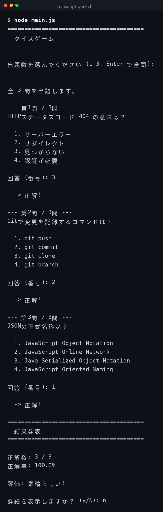

English | [日本語](ja/README.md) | [한국어](ko/README.md)

# javascript-quiz-cli


## Overview

A command-line quiz game. It randomly presents 10 IT-related questions, scores your answers, and displays the results. You can choose the number of questions, and review detailed results after finishing.

## Demo



*Actual output. The CLI interface is in Japanese.*

## Features

- 10 built-in IT-related quiz questions
- Random question selection with configurable count
- Interactive number-based answer input
- Score display and detailed results review after completion
- Customizable questions via an external JSON file
- Uses only Node.js standard modules

## Requirements

- Node.js 14 or higher (standard modules only)

## Quick Start

```bash
git clone https://github.com/mivork/javascript-quiz-cli.git
cd javascript-quiz-cli
node main.js
```

You will be prompted to select the number of questions and answer by entering a number.

## Usage

| Command | Description |
|---|---|
| `node main.js` | Start the quiz |

## Customizing Questions

Place a `quiz.json` file in the same directory to use your own questions.

```json
[
  {
    "question": "Your question here",
    "choices": ["Choice 1", "Choice 2", "Choice 3", "Choice 4"],
    "answer": 0
  }
]
```

`answer` is a zero-based index. If the file is not present, the built-in 10 questions will be used.

## License

This project is licensed under the MIT License.
