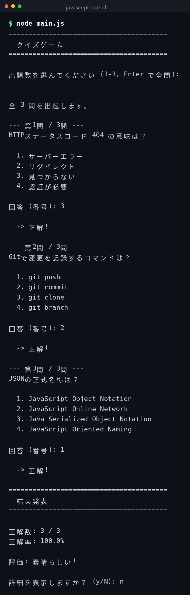

[English](../README.md) | 日本語 | [한국어](../ko/README.md)

# javascript-quiz-cli


## 概要

コマンドラインで動くクイズゲームです。IT系の問題10問をランダムに出題し、採点して結果を表示します。出題数を選択でき、終了後に詳細結果も確認できます。

## デモ



## Features

- IT系のクイズ問題10問を内蔵
- 出題数を選択してランダムに出題できる
- 番号入力による対話形式の回答
- 終了後にスコアと詳細結果を確認できる
- 外部 JSON ファイルで問題をカスタマイズできる
- Node.js の標準モジュールのみを使用

## 必要環境

- Node.js 14 以上（標準モジュールのみ使用）

## Quick Start

```bash
git clone https://github.com/mivork/javascript-quiz-cli.git
cd javascript-quiz-cli
node main.js
```

対話形式で出題数を選び、番号で回答します。

## コマンド一覧

| コマンド | 説明 |
|---|---|
| `node main.js` | クイズを開始する |

## 問題のカスタマイズ

`quiz.json` を同じディレクトリに置くと、そちらの問題が使われます。

```json
[
  {
    "question": "問題文",
    "choices": ["選択肢1", "選択肢2", "選択肢3", "選択肢4"],
    "answer": 0
  }
]
```

`answer` は0始まりのインデックスです。ファイルがなければ内蔵の10問が使われます。

## ライセンス

このプロジェクトは MIT ライセンスの下で公開されています。
