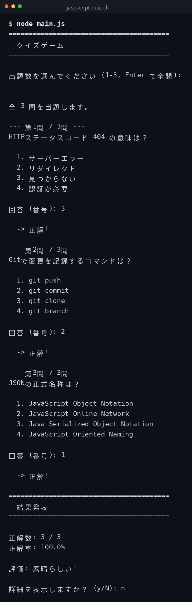

[English](../README.md) | [日本語](../ja/README.md) | 한국어

# javascript-quiz-cli


## 개요

커맨드라인에서 동작하는 퀴즈 게임입니다. IT 관련 문제 10개를 랜덤으로 출제하고, 채점하여 결과를 표시합니다. 출제 수를 선택할 수 있으며, 종료 후 상세 결과도 확인할 수 있습니다.

## 데모



*실제 출력입니다. CLI 인터페이스는 일본어입니다.*

## Features

- IT 관련 퀴즈 문제 10개 내장
- 출제 수를 선택하여 랜덤으로 출제할 수 있음
- 번호 입력을 통한 대화형 응답
- 종료 후 점수 및 상세 결과를 확인할 수 있음
- 외부 JSON 파일로 문제를 커스터마이즈할 수 있음
- Node.js 표준 모듈만 사용

## 필요 환경

- Node.js 14 이상 (표준 모듈만 사용)

## Quick Start

```bash
git clone https://github.com/mivork/javascript-quiz-cli.git
cd javascript-quiz-cli
node main.js
```

대화형으로 출제 수를 선택하고 번호로 응답합니다.

## 사용법

| 명령어 | 설명 |
|---|---|
| `node main.js` | 퀴즈를 시작한다 |

## 문제 커스터마이즈

`quiz.json`을 같은 디렉터리에 배치하면 해당 파일의 문제가 사용됩니다.

```json
[
  {
    "question": "문제 내용",
    "choices": ["선택지 1", "선택지 2", "선택지 3", "선택지 4"],
    "answer": 0
  }
]
```

`answer`는 0부터 시작하는 인덱스입니다. 파일이 없으면 내장된 10개 문제가 사용됩니다.

## 라이선스

이 프로젝트는 MIT 라이선스 하에 공개되어 있습니다.
